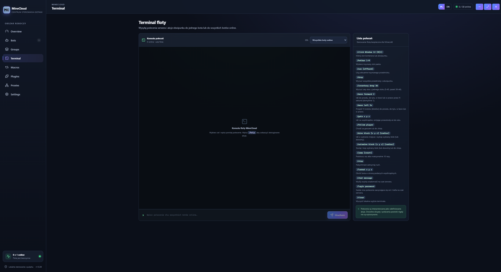
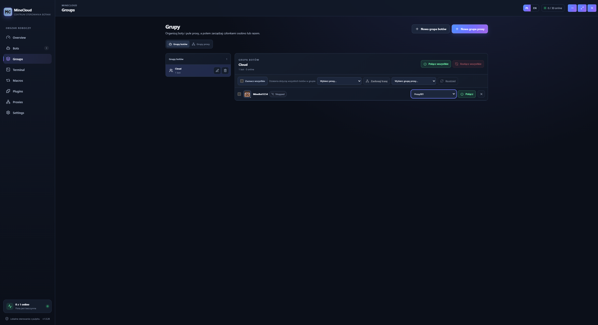
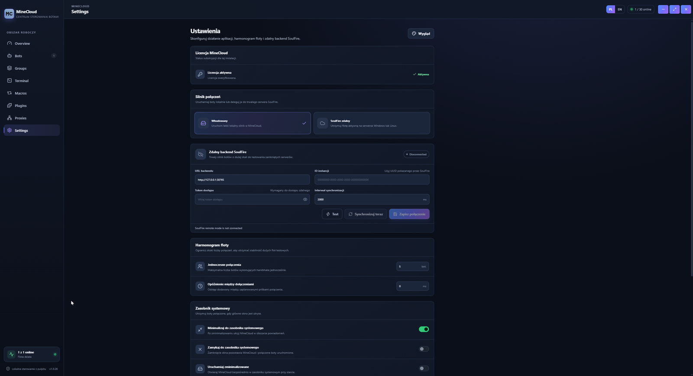
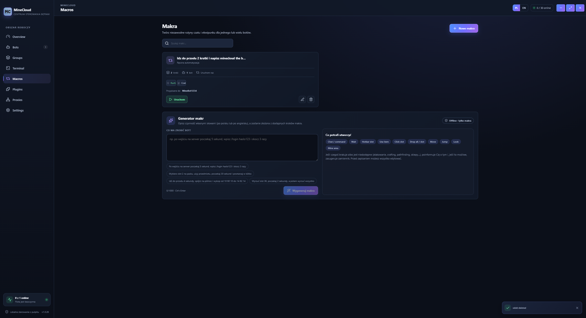
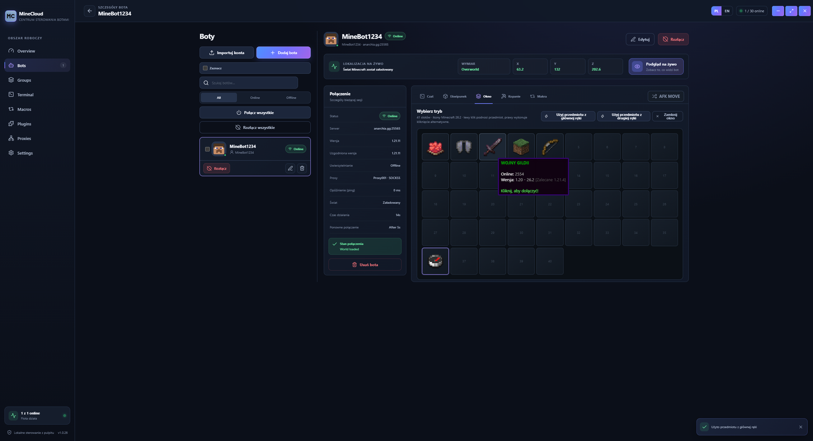
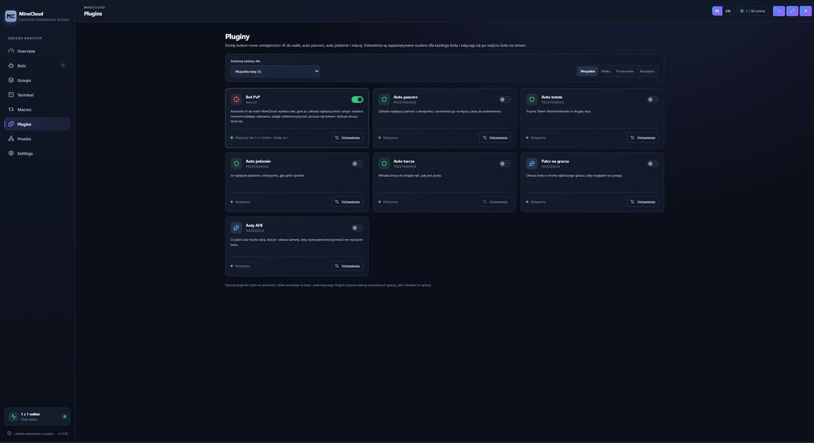
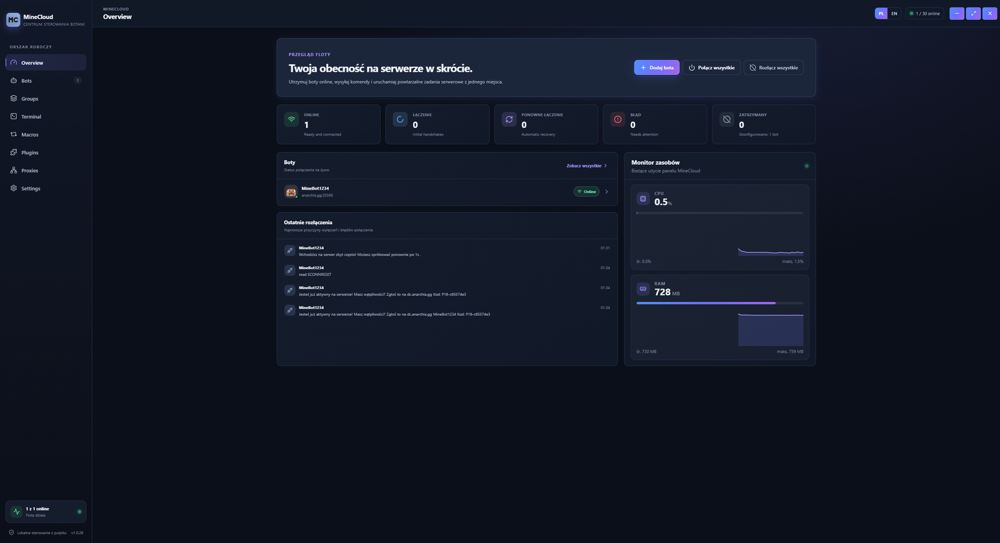
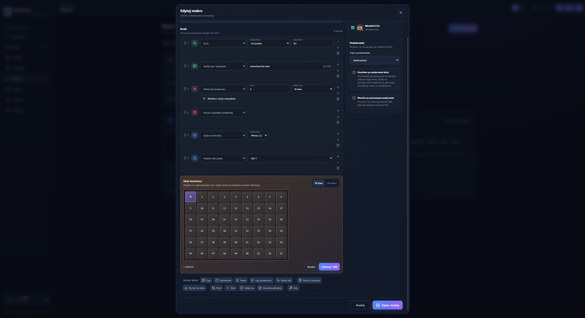
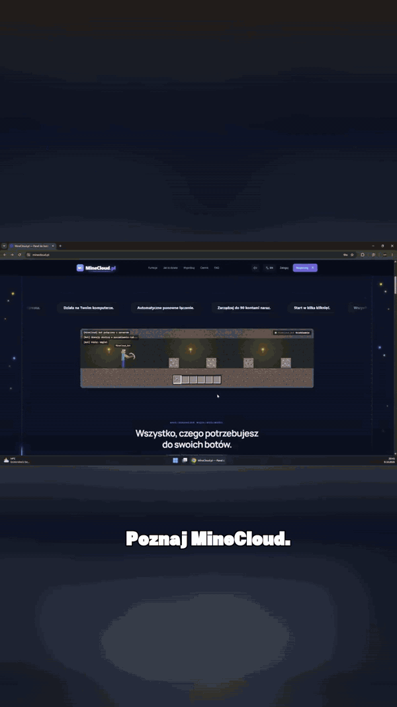

<p align="center">
  
</p>

<h1 align="center">MineCloud</h1>

<p align="center">
  <strong>Panel do botów Minecraft. Na Twoim komputerze.</strong>
</p>

<p align="center">
  Uruchamiaj, konfiguruj i zarządzaj botami Minecraft — AFK, kopanie, farmienie i wiele kont — z jednego panelu na Windows.
</p>

<p align="center">
  <a href="https://minecloud.pl"></a>
  <a href="https://minecloud.pl"></a>
  <a href="https://discord.gg/h2VjgdvM62"></a>
  <a href="https://www.tiktok.com/@minecloud0"></a>
  <a href="https://minecloud.pl"></a>
</p>

<p align="center">
  <a href="https://github.com/ArcadyXDDD/MineClouds/releases/latest/download/MineCloud-Setup-Free-Trial.exe"><strong>Pobierz wersję testową</strong></a>
  &nbsp;·&nbsp;
  <a href="https://minecloud.pl/plans"><strong>Zobacz plany</strong></a>
  &nbsp;·&nbsp;
  <a href="https://discord.gg/h2VjgdvM62"><strong>Discord</strong></a>
</p>

<p align="center">
  <sub>Działa lokalnie na Windows &nbsp;·&nbsp; Licencja na kod aktywacyjny &nbsp;·&nbsp; Panel w przeglądarce</sub>
</p>

---

## Panel w praktyce

Prawdziwe widoki panelu: terminal, grupy, makra, pluginy i przegląd floty. Pełna galeria jest na stronie [minecloud.pl/galeria](https://minecloud.pl/galeria).

<table>
  <tr>
    <td width="50%" align="center" valign="top">
      
      <br />
      <strong>Terminal floty</strong>
      <br />
      <sub>Jedna konsola dla całej floty — polecenia serwera i akcje ekwipunku na wszystkich botach online.</sub>
    </td>
    <td width="50%" align="center" valign="top">
      
      <br />
      <strong>Grupy botów</strong>
      <br />
      <sub>Grupuj boty i proxy, a potem łącz i rozłączaj całą grupę jednym kliknięciem.</sub>
    </td>
  </tr>
  <tr>
    <td width="50%" align="center" valign="top">
      
      <br />
      <strong>Ustawienia</strong>
      <br />
      <sub>Licencja, silnik połączeń, backend SoulFire i harmonogram floty w jednym miejscu.</sub>
    </td>
    <td width="50%" align="center" valign="top">
      
      <br />
      <strong>Makra</strong>
      <br />
      <sub>Gotowe sekwencje czasu i ekwipunku — opisujesz, co bot ma zrobić, i uruchamiasz.</sub>
    </td>
  </tr>
  <tr>
    <td width="50%" align="center" valign="top">
      
      <br />
      <strong>Szczegóły bota</strong>
      <br />
      <sub>Status sesji, wersja, proxy i wybór serwera z listy — wszystko przy jednym koncie.</sub>
    </td>
    <td width="50%" align="center" valign="top">
      
      <br />
      <strong>Pluginy</strong>
      <br />
      <sub>Auto pancerz, jedzenie, totem, PvP i AFK — włączasz tylko to, czego potrzebuje bot.</sub>
    </td>
  </tr>
  <tr>
    <td width="50%" align="center" valign="top">
      
      <br />
      <strong>Przegląd floty</strong>
      <br />
      <sub>Kto jest online, ostatnie połączenia i zużycie CPU oraz RAM panelu na żywo.</sub>
    </td>
    <td width="50%" align="center" valign="top">
      
      <br />
      <strong>Edytor makra</strong>
      <br />
      <sub>Kroki, opóźnienia i wybór slotów ekwipunku — makro układasz wizualnie, bez skryptów.</sub>
    </td>
  </tr>
</table>

<p align="center">
  <a href="https://www.youtube.com/watch?v=Y9XHHLa7_gc">
    
  </a>
</p>

<p align="center">
  <a href="https://www.youtube.com/watch?v=Y9XHHLa7_gc"><strong>Obejrzyj pełny film</strong></a>
  <br />
  <sub>Kanał <a href="https://www.youtube.com/@MineCloudPL">MineCloudPL</a></sub>
</p>

---

## Wszystko, czego potrzebujesz

Jeden panel. Pełna kontrola. Bez zbędnej konfiguracji.

<table>
  <tr>
    <td width="50%" valign="top">

**💻 Panel na Twoim komputerze**  
Uruchamiasz MineCloud lokalnie na swoim komputerze.

</td>
    <td width="50%" valign="top">

**🌐 Panel w przeglądarce**  
Zarządzaj botami z poziomu przeglądarki. Bez dodatkowych instalacji.

</td>
  </tr>
  <tr>
    <td width="50%" valign="top">

**⚙️ Automatyzacja**  
Twórz własne działania i automatyzuj powtarzalne zadania.

</td>
    <td width="50%" valign="top">

**📊 Monitoring na żywo**  
Status, ping, RAM, CPU i czas działania. Wszystko w jednym miejscu.

</td>
  </tr>
  <tr>
    <td width="50%" valign="top">

**👥 Wiele botów. Jeden panel.**  
Zarządzaj wieloma botami z jednego panelu, bez przełączania narzędzi.

</td>
    <td width="50%" valign="top">

**🔄 Restart jednym kliknięciem**  
Uruchamiaj, zatrzymuj i restartuj boty wtedy, kiedy potrzebujesz.

</td>
  </tr>
</table>

### Boty pracują za Ciebie

<table>
  <tr>
    <td width="50%" valign="top">

**Automatyzacje**  
Ustawiasz farmienie, kopanie i przetapianie raz. Panel powtarza sekwencję za Ciebie.

</td>
    <td width="50%" valign="top">

**Komendy**  
Wysyłasz komendy do wielu botów z jednego miejsca i układasz je w kolejce.

</td>
  </tr>
  <tr>
    <td width="50%" valign="top">

**Wiele funkcji**  
Survival, AFK i mining w jednym panelu. Bez przełączania okien i narzędzi.

</td>
    <td width="50%" valign="top">

**Podgląd statusu**  
Ping, czas działania i stan sesji widać od razu — na komputerze, na którym działa panel.

</td>
  </tr>
  <tr>
    <td width="50%" valign="top">

**Z dowolnego urządzenia**  
Panel otwierasz w przeglądarce, więc stan botów sprawdzisz też z telefonu w swojej sieci.

</td>
    <td width="50%" valign="top">

**Live na życzenie**  
Podgląd live włączasz, kiedy chcesz — i zarządzasz botami prosto z panelu.

</td>
  </tr>
</table>

### Masz pełną kontrolę nad zasobami

Panel pokazuje, ile procesora i pamięci zużywają boty. Jest zoptymalizowany pod duże obciążenie i stabilnie obsługuje dziesiątki kont działających jednocześnie.

- **Kontrola zasobów.** Procesor, pamięć i ping widzisz na żywo, bez otwierania dodatkowych programów.
- **Obciążenie per bot.** Sprawdzasz, który bot zużywa najwięcej, i od razu wiesz, gdzie reagować.
- **Duże obciążenie.** Lekki panel utrzymuje wiele kont w jednej sesji.

---

## Automatyzuj. Nie powtarzaj.

Łącz zdarzenia, komendy i działania w przejrzyste makra. Raz ustawiasz zasady. Bot wie, co robić dalej.

- Przejrzysty, wizualny przepływ
- Komendy i opóźnienia w jednej sekwencji
- Twoje pomysły. Twoja automatyzacja.

Działania konfigurujesz sam w panelu. Poniżej sekwencja „Wejście na serwer” pokazana na [minecloud.pl](https://minecloud.pl):

```text
WEJŚCIE NA SERWER

1  PO POŁĄCZENIU            /warp afk
2  ODCZEKAJ 5 SEKUND        /wait 5ms
3  WYŚLIJ KOMENDĘ           /open gui
4  ODCZEKAJ 10 SEKUND       /wait 10ms
5  PRZEJDŹ DO LOKALIZACJI   X: 128 · Y: 64 · Z: −32
6  ROZPOCZNIJ ZADANIE       Uruchom sekwencję
```

---

## Wersje Minecraft

Na stronie podany jest zakres:

`1.8` · `1.12` · `1.16` · `1.20` · `1.21` · i wiele więcej

Planowany zakres wersji. Potwierdzona lista zgodności pojawi się przed premierą.

---

## Trzy kroki. I jesteś online.

Wszystko kontrolujesz z poziomu panelu MineCloud.

<table>
  <tr>
    <td width="33%" align="center" valign="top">

**01**

**Kup licencję**

Kupujesz licencję i otrzymujesz kod aktywacyjny panelu.

</td>
    <td width="33%" align="center" valign="top">

**02**

**Dodaj swojego bota**

Ustaw serwer, wersję i funkcje bota.

</td>
    <td width="33%" align="center" valign="top">

**03**

**Uruchom i zarządzaj**

Kliknij start. Resztę zostaw panelowi.

</td>
  </tr>
</table>

<p align="center">
  <sub>Zanim kupisz licencję, możesz uruchomić pełny panel w wersji testowej — opis niżej.</sub>
</p>

---

## Panel jest w 100% bezpieczny

MineCloud nigdy nie przechowuje danych logowania. Wszystko działa lokalnie na Twoim komputerze — bez serwerów pośredniczących.

<table>
  <tr>
    <td width="33%" valign="top">

**Zero przechowywania haseł**  
Twoje hasło nigdy nie opuszcza Twojego komputera. Panel nie wysyła żadnych danych logowania na zewnątrz.

</td>
    <td width="33%" valign="top">

**Działa w 100% lokalnie**  
Aplikacja uruchamia się bezpośrednio na Twoim Windows. Żadne dane nie wychodzą poza Twój komputer.

</td>
    <td width="33%" valign="top">

**Alert Windows — bez obaw**  
Windows może pokazać ostrzeżenie przy pierwszym uruchomieniu. To normalne — brak podpisu cyfrowego nie oznacza wirusa. Ostrzeżenie wynika wyłącznie z braku komercyjnego podpisu cyfrowego.

</td>
  </tr>
</table>

---

## Przetestuj MineCloud za darmo

Pobierz aplikację, uruchom ją na swoim komputerze i sprawdź, jak wygodnie zarządza się botami. Bez zobowiązań.

- Bez karty płatniczej
- Start w kilka minut
- Działa lokalnie na Windows
- Pełny panel do testów
- Wersja dla **Windows 10 / 11**

<p align="center">
  <a href="https://github.com/ArcadyXDDD/MineClouds/releases/latest/download/MineCloud-Setup-Free-Trial.exe"></a>
</p>

<p align="center">
  Instalator: <a href="https://github.com/ArcadyXDDD/MineClouds/releases/latest/download/MineCloud-Setup-Free-Trial.exe"><code>MineCloud-Setup-Free-Trial.exe</code></a>
  <br />
  <sub>Na Discordzie możesz też odebrać darmową licencję testową, zadać pytanie i śledzić nowości.</sub>
</p>

<p align="center">
  <a href="https://discord.gg/h2VjgdvM62"></a>
  &nbsp;
  <a href="https://www.tiktok.com/@minecloud0"></a>
</p>

---

## Licencja abonamentowa

Kupujesz licencję MineCloud i otrzymujesz kod aktywacyjny. Panel uruchamiasz na swoim komputerze z systemem Windows. Ceny poniżej są tymi, które pokazuje [cennik na minecloud.pl](https://minecloud.pl/#cennik).

| Plan | Miesięcznie | Rocznie | Konta jednocześnie | W pakiecie |
| --- | ---: | ---: | --- | --- |
| **Standard** | $6.00 | $59.00 | do 30 | Panel, start i stop botów, podstawowe ustawienia, podstawowe automatyzacje |
| **Pro** | $11.00 | $99.00 | do 60 | Zaawansowane ustawienia, ponowne łączenie, więcej botów, rozbudowane automatyzacje, podgląd statusu, więcej konfiguracji serwerów |
| **Premium** | $15.00 | $139.00 | do 90 | Wszystko z Pro, wiele kont, automatyczny start, darmowe proxy na start, szczegółowy status, duże konfiguracje, priorytetowa pomoc |

Pro jest oznaczony na stronie jako najpopularniejszy. Przy rozliczeniu rocznym strona pokazuje oszczędność: Standard 18%, Pro 25%, Premium 23%.

- Anuluj w dowolnym momencie
- Bez ukrytych opłat
- Bezpieczna płatność

Limity kont zależą od wybranej licencji. Większe limity na razie nie będą wprowadzane.

<p align="center">
  <a href="https://minecloud.pl/plans"><strong>Wybierz plan na minecloud.pl/plans</strong></a>
</p>

---

## Pytania

Najważniejsze informacje przed zakupem licencji. Odpowiedzi pochodzą z FAQ na stronie.

<details>
<summary><strong>Czy MineCloud hostuje moje boty w chmurze?</strong></summary>

Nie. MineCloud to panel, który uruchamiasz na własnym komputerze z systemem Windows. Boty działają u Ciebie — panel pozwala nimi zarządzać. Opcjonalnie możesz podłączyć panel do serwera lub uruchomić go na VPS.

</details>

<details>
<summary><strong>Na jakim systemie działa MineCloud?</strong></summary>

MineCloud jest panelem uruchamianym na systemie Windows. Korzystanie z panelu na własnym komputerze nie wymaga dodatkowych kosztów poza jednorazowym zakupem licencji.

</details>

<details>
<summary><strong>Jak działa licencja MineCloud?</strong></summary>

Licencja MineCloud działa na zasadach abonamentu. Po zakupie otrzymujesz kod aktywacyjny, którym aktywujesz panel na swoim komputerze z systemem Windows. Opcjonalnie możesz podłączyć panel do serwera lub uruchomić go na VPS.

</details>

<details>
<summary><strong>Czy mogę uruchomić panel na serwerze lub VPS?</strong></summary>

Tak, to zalecana opcja, gdy Twój komputer posiada mniej niż 8 GB RAM. Możesz podłączyć panel do serwera lub uruchomić go na VPS. Ewentualne koszty zależą od wybranej przez Ciebie infrastruktury.

</details>

<details>
<summary><strong>Ile botów mogę uruchomić?</strong></summary>

W trakcie trwania licencji możesz uruchamiać tyle botów, ile pozwala ograniczenie przez licencję. Większe limity na razie nie będą wprowadzane.

</details>

<details>
<summary><strong>Czy mogę zarządzać botem z telefonu?</strong></summary>

Panel jest dostępny w oknie przeglądarki, więc możesz zarządzać botami z dowolnego urządzenia w Twojej sieci. Wymagany VPS.

</details>

<details>
<summary><strong>Czy MineCloud obsługuje automatyzacje?</strong></summary>

Tak, automatyzacje są częścią panelu. Panel posiada zaawansowane funkcje macro oraz wiele innych opcji automatyzacji.

</details>

---

<p align="center">
  <a href="https://minecloud.pl">Strona</a>
  &nbsp;·&nbsp;
  <a href="https://minecloud.pl/galeria">Galeria</a>
  &nbsp;·&nbsp;
  <a href="https://minecloud.pl/plans">Plany</a>
  &nbsp;·&nbsp;
  <a href="https://minecloud.pl/faq">FAQ</a>
  &nbsp;·&nbsp;
  <a href="https://minecloud.pl/poradnik/bot-afk-minecraft">Poradnik: bot AFK</a>
  &nbsp;·&nbsp;
  <a href="https://minecloud.pl/regulamin">Regulamin</a>
  &nbsp;·&nbsp;
  <a href="https://minecloud.pl/polityka-prywatnosci">Polityka prywatności</a>
</p>

<p align="center">
  <a href="https://discord.gg/h2VjgdvM62">Discord</a>
  &nbsp;·&nbsp;
  <a href="https://www.tiktok.com/@minecloud0">TikTok</a>
  &nbsp;·&nbsp;
  <a href="https://www.youtube.com/@MineCloudPL">YouTube</a>
  &nbsp;·&nbsp;
  <a href="https://github.com/ArcadyXDDD/MineClouds/releases/latest/download/MineCloud-Setup-Free-Trial.exe">Pobierz</a>
</p>

<p align="center">
  <sub>© 2026 MineCloud.pl. Wszelkie prawa zastrzeżone.</sub>
  <br />
  <sub>MineCloud nie jest powiązany z Mojang Studios ani Microsoft.</sub>
  <br />
  <sub>Zbudowane dla Twoich botów.</sub>
</p>
